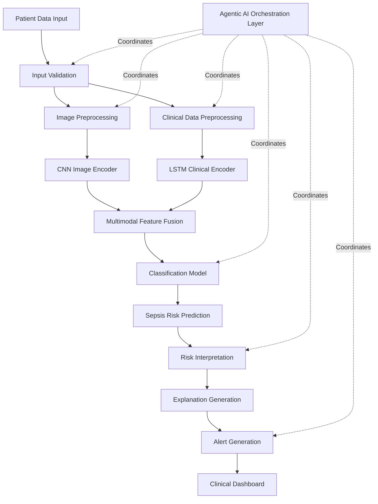

# Multimodal Sepsis Prediction Using Deep Learning and Agentic AI

**A multimodal clinical decision-support research project combining chest X-ray images, ICU clinical time-series data, CNN–LSTM deep learning, and Agentic AI for early sepsis risk prediction.**


## 📌 Table of Contents

- [Overview](#overview)
- [Problem Statement](#problem-statement)
- [Objectives](#objectives)
- [Proposed System Architecture](#proposed-system-architecture)
- [Core Components](#core-components)
- [Dataset and Data Sources](#dataset-and-data-sources)
- [Technology Stack](#technology-stack)
- [Project Structure](#project-structure)
- [Installation and Setup](#installation-and-setup)
- [Proposed Workflow](#proposed-workflow)
- [Evaluation Metrics](#evaluation-metrics)
- [Research Gaps Addressed](#research-gaps-addressed)
- [Privacy, Ethics, and Limitations](#privacy-ethics-and-limitations)
- [Project Status](#project-status)
- [Future Enhancements](#future-enhancements)
- [Acknowledgements](#acknowledgements)

## 🧠 Overview

Sepsis is a life-threatening condition caused by the body's dysregulated response to infection. Early identification of patients at risk is essential because delays in recognition and treatment can lead to severe complications.

This project proposes a **multimodal deep learning framework for early sepsis risk prediction** by integrating two complementary data modalities:

1. **Chest X-ray images:** A Convolutional Neural Network (CNN) extracts visual features from medical images.
2. **ICU clinical time-series data:** A Long Short-Term Memory (LSTM) network learns temporal patterns from patient measurements collected over time.

The features extracted from these two modalities are combined through a multimodal fusion mechanism to generate a sepsis risk prediction.

An **Agentic AI layer** is designed to coordinate input validation, preprocessing, model inference, risk interpretation, explanation generation, and alert delivery through a clinical dashboard.

The primary goal is to investigate whether combining medical imaging and longitudinal clinical information can support more comprehensive sepsis risk assessment than using either modality independently.

## 🎯 Problem Statement

Traditional clinical assessment involves analyzing multiple sources of patient information, including vital signs, laboratory results, medical history, and imaging studies.

When these data sources are analyzed independently, potentially useful relationships between clinical changes and imaging findings may be overlooked.

This project addresses the need for an integrated prediction framework that combines medical imaging and ICU clinical data using multimodal deep learning.

The proposed system aims to provide an organized prediction workflow and clinically relevant risk information to support healthcare professionals in reviewing patients who may be at risk of sepsis.

## 🎯 Objectives

- Integrate chest X-ray images and structured ICU clinical data.
- Extract visual representations using a CNN-based image encoder.
- Learn temporal dependencies in clinical measurements using an LSTM network.
- Combine image and clinical features using multimodal fusion.
- Generate model-based sepsis risk predictions.
- Design an Agentic AI workflow to coordinate the prediction pipeline.
- Provide prediction results and configured alerts through a dashboard.
- Evaluate the proposed model against suitable single-modality baselines.
- Investigate the limitations and practical considerations of multimodal clinical AI.

## 🏗️ Proposed System Architecture



**Architecture explanation:**

- The input layer receives chest X-ray images and ICU clinical measurements.
- The validation and preprocessing stages prepare the data for the appropriate model branches.
- The CNN extracts image features, while the LSTM processes clinical sequences.
- The multimodal fusion module combines both representations.
- The classification model generates a prediction based on its training labels and defined prediction horizon.
- The Agentic AI layer coordinates the workflow and supports result presentation.
- The dashboard presents prediction-related information for review by authorized users.

This is the proposed architecture; individual components must be implemented and tested before being considered operational.

## 🔬 Core Components

### 1. Chest X-ray Image Processing

Chest X-ray images provide visual information about thoracic structures and possible abnormalities relevant to a patient's clinical condition.

The image-processing pipeline is designed to:

- Validate image files and supported formats.
- Resize images to the required input dimensions.
- Normalize image values.
- Apply appropriate preprocessing.
- Extract image features using a CNN-based encoder.

Chest X-ray findings are not specific to sepsis. The image branch provides complementary information and is not intended to diagnose sepsis independently.

### 2. ICU Clinical Data Processing

ICU clinical data provide structured information about a patient's physiological condition over time.

Potential input features include:

- Heart rate.
- Respiratory rate.
- Body temperature.
- Blood pressure.
- White blood cell count.
- Platelet count.
- Lactate levels, when available.
- Other relevant laboratory measurements and clinical variables.

The final feature set depends on dataset availability and the documented experimental protocol.

Preprocessing may include missing-value handling, normalization, feature scaling, timestamp validation, and temporal sequence construction.

### 3. CNN-Based Image Feature Extraction

A Convolutional Neural Network learns spatial representations from chest X-ray images.

The CNN processes an image and generates a feature representation that captures learned visual patterns. This representation is passed to the multimodal fusion stage.

The final CNN architecture will be selected and documented during implementation and experimentation.

### 4. LSTM-Based Temporal Modeling

A Long Short-Term Memory network processes sequences of ICU clinical measurements.

The LSTM is intended to learn patterns in patient measurements over time rather than relying exclusively on a single observation.

Its output is a temporal clinical representation that can be combined with the image features.

### 5. Multimodal Feature Fusion

The fusion module combines:

- Image features extracted by the CNN.
- Temporal clinical features extracted by the LSTM.

The proposed approach uses feature-level fusion followed by a classification head.

The model output will depend on the training labels, prediction horizon, and validated decision threshold. Performance improvements must be demonstrated experimentally by comparing the multimodal model with appropriate baseline models.

### 6. Agentic AI Workflow

Agentic AI refers to an AI system that coordinates multiple steps toward a defined goal using workflow logic, tools, and intermediate results where appropriate.

In this project, Agentic AI acts as a **workflow orchestration and coordination layer around the multimodal prediction model**. It does not replace the CNN, LSTM, or fusion classifier.

The planned workflow components are:

| Component | Responsibility |
|---|---|
| Input Validation Agent | Checks whether required inputs are present and structurally valid. |
| Preprocessing Agent | Coordinates image and clinical data preprocessing. |
| Prediction Agent | Invokes the trained multimodal model and obtains its output. |
| Risk Analysis Agent | Interprets prediction outputs using documented decision rules. |
| Explanation Agent | Presents available prediction-related information in an understandable format. |
| Alert Generation Agent | Prepares alerts when configured criteria are satisfied. |
| Dashboard Integration | Makes results available to authorized users. |

These are proposed responsibilities. Their implementation, degree of autonomy, and error-handling mechanisms will be established through development and testing.

The system is intended to support clinical review, not independently establish a diagnosis or make treatment decisions.

## 📊 Dataset and Data Sources

The project is designed around two principal data modalities.

| Data Type | Candidate Dataset | Purpose |
|---|---|---|
| ICU clinical records | [MIMIC-IV](https://physionet.org/content/mimiciv/) | Clinical measurements and temporal sequences |
| Chest X-ray images | [MIMIC-CXR](https://physionet.org/content/mimic-cxr/) | Medical image feature extraction |
| Sepsis outcome labels | Appropriately defined or documented clinical labels | Model training and evaluation |

### Dataset Preparation

Before training, the project must establish:

- Dataset access and licensing requirements.
- Patient inclusion and exclusion criteria.
- The definition of sepsis labels.
- The observation window and prediction horizon.
- Rules for matching clinical records and imaging studies.
- Missing-value and missing-modality handling.
- Patient-level training, validation, and test splits.

MIMIC-IV and MIMIC-CXR are proposed data sources. Their use in the completed training pipeline must be verified and documented separately.

## 💻 Technology Stack

| Category | Technologies |
|---|---|
| Programming Language | Python |
| Deep Learning | CNN, LSTM |
| Image Processing | OpenCV, NumPy |
| Data Processing | Pandas, NumPy, SciPy |
| Multimodal Learning | Feature Fusion |
| Frontend | React, Vite |
| Backend | API service, according to the repository configuration |
| Database | Database layer defined by project configuration |
| Testing | Python test suite |
| Containerization | Docker, Docker Compose |
| Version Control | Git, GitHub |
| API Testing | Postman, where applicable |

Exact dependencies and versions should be taken from the repository's configuration files.

## 📁 Project Structure

The following top-level structure corresponds to the public repository layout. Nested files may evolve during implementation.

```text
multimodal-sepsis-prediction/
│
├── .github/
│   └── workflows/
│
├── agents/
│
├── backend/
│
├── common/
│
├── configs/
│
├── database/
│
├── docs/
│
├── frontend/
│
├── ml/
│
├── scripts/
│
├── tests/
│
├── .env.example
├── .gitignore
├── Dockerfile.backend
├── Dockerfile.frontend
├── PHASES_APPLIED.md
├── docker-compose.yml
├── pyproject.toml
└── README.md
```

### Directory Descriptions

- **`.github/workflows/`** — CI and repository automation workflows.
- **`agents/`** — Agentic AI orchestration and workflow components.
- **`backend/`** — Backend API and application logic.
- **`common/`** — Shared modules and utilities.
- **`configs/`** — Application and model configuration.
- **`database/`** — Database-related components.
- **`docs/`** — Technical and project documentation.
- **`frontend/`** — Web interface and dashboard.
- **`ml/`** — Machine learning data preparation, models, training, and inference.
- **`scripts/`** — Utility and development scripts.
- **`tests/`** — Automated tests.
- **`.env.example`** — Example environment variables.
- **`Dockerfile.backend`** — Backend container build configuration.
- **`Dockerfile.frontend`** — Frontend container build configuration.
- **`docker-compose.yml`** — Multi-service container configuration.
- **`pyproject.toml`** — Python project and tool configuration.
- **`PHASES_APPLIED.md`** — Project phase and implementation notes.

Directory descriptions indicate intended responsibilities; refer to the actual files for the current implementation.

## ⚙️ Installation and Setup

### Prerequisites

- Git.
- Python compatible with `pyproject.toml`.
- Node.js and npm for frontend development.
- Docker and Docker Compose for containerized execution.
- Authorized access to the required datasets.

### Step 1: Clone the Repository

```bash
git clone https://github.com/Aditya-Dandotkar/multimodal-sepsis-prediction.git
cd multimodal-sepsis-prediction
```

### Step 2: Create a Python Virtual Environment

```bash
python -m venv .venv
```

On Windows PowerShell, activate it using:

```powershell
.\.venv\Scripts\Activate.ps1
```

### Step 3: Configure Environment Variables

Copy the example configuration:

```powershell
Copy-Item .env.example .env
```

Update the local `.env` file according to the actual application configuration.

Never commit database passwords, API keys, access tokens, or private patient data.

### Step 4: Install Dependencies

Check `pyproject.toml` for the supported Python installation command and dependency groups.

Install frontend dependencies from the `frontend/` directory using the package manager and lockfile available in that directory.

### Step 5: Run the Application

If the Docker Compose configuration is ready for local execution, review it and run:

```bash
docker compose up --build
```

The exact startup process depends on the current backend entry point, frontend scripts, environment configuration, and service definitions.

**Note:** The command may require adjustments if the configuration or application components are still under development. Model weights and restricted datasets should not be assumed to be included in the repository.

## 🔄 Proposed Workflow

1. Acquire authorized ICU clinical data and chest X-ray images.
2. Validate clinical records, image files, timestamps, and outcome labels.
3. Preprocess images and clinical measurements separately.
4. Construct patient-level examples with a defined observation window.
5. Train the CNN image branch.
6. Train the LSTM clinical branch.
7. Combine both representations using multimodal feature fusion.
8. Train and evaluate the classification model.
9. Compare multimodal performance against single-modality baselines.
10. Integrate the model with the backend inference pipeline.
11. Coordinate validation, inference, interpretation, and alert handling through the Agentic AI layer.
12. Present results through the frontend dashboard.

## 📈 Evaluation Metrics

The model should be evaluated using appropriate classification and clinical-risk metrics.

- **AUROC:** Measures discrimination across classification thresholds.
- **AUPRC:** Assesses precision-recall performance, particularly relevant for imbalanced datasets.
- **Precision:** Measures the proportion of positive predictions that are correct.
- **Recall / Sensitivity:** Measures the proportion of actual positive cases identified.
- **Specificity:** Measures the proportion of actual negative cases identified.
- **F1-score:** Combines precision and recall.
- **Confusion Matrix:** Summarizes classification outcomes.
- **Calibration:** Assesses how well predicted probabilities correspond to observed outcomes.
- **Early-warning lead time:** Evaluates how far in advance risk is predicted, where supported by the study design.

Evaluation must use a held-out patient-level test set and clearly document the cohort, label definition, observation window, prediction horizon, and selected operating threshold.

No performance values should be reported until they are obtained from reproducible experiments.

## 🔍 Research Gaps Addressed

The project investigates the following research directions:

### 1. Limited Integration of Multiple Modalities

Investigates combining medical imaging with structured clinical measurements instead of relying exclusively on one data modality.

### 2. Temporal Clinical Pattern Modeling

Uses LSTM-based sequence modeling to learn temporal patterns in ICU clinical measurements.

### 3. Multimodal Feature Fusion

Evaluates whether combining image and clinical representations provides useful predictive information beyond individual-modality models.

### 4. Agentic AI Workflow Coordination

Explores an orchestration layer that coordinates validation, preprocessing, inference, interpretation, and alert delivery.

### 5. Clinical Decision-Support Presentation

Aims to organize model predictions and supporting information through a dashboard for review by authorized users.

These are research objectives to evaluate, not claims that all existing approaches lack these capabilities or that the proposed system has already resolved the gaps.

## 🔐 Privacy, Ethics, and Limitations

- This project is an academic research prototype and is not a clinically validated medical device.
- A model prediction is not a medical diagnosis.
- Chest X-ray findings are not specific to sepsis.
- Dataset bias, missing values, label quality, and population differences can affect performance.
- Retrospective evaluation does not establish effectiveness in real-world clinical practice.
- Dataset licensing, de-identification, access controls, and secure storage requirements must be followed.
- Alerts and risk thresholds require appropriate validation and human oversight.
- The system must not independently initiate treatment or delay urgent clinical care.

## 🚧 Project Status

**Current status: Under development.**

The repository contains separate top-level areas for agents, backend services, frontend, machine learning, configuration, database components, documentation, scripts, and tests.

The presence of a directory does not necessarily mean its components are complete, trained, tested, or clinically validated.

### Development Checklist

- [ ] Verify dataset access and document cohort definitions.
- [ ] Complete and test image preprocessing.
- [ ] Complete and test clinical sequence preprocessing.
- [ ] Implement and train the CNN image branch.
- [ ] Implement and train the LSTM clinical branch.
- [ ] Implement and evaluate multimodal fusion.
- [ ] Implement and test the Agentic AI workflow.
- [ ] Integrate model inference with the backend.
- [ ] Integrate the frontend dashboard.
- [ ] Run automated tests and document the results.
- [ ] Report reproducible evaluation metrics.
- [ ] Document limitations and future validation requirements.

Update this checklist as components are completed and verified.

## 🚀 Future Enhancements

- Compare different CNN architectures and temporal models.
- Evaluate alternative multimodal fusion strategies.
- Investigate robust handling of missing modalities.
- Improve calibration and uncertainty reporting.
- Evaluate generalization across patient cohorts.
- Strengthen agent workflow monitoring and error handling.
- Explore secure integration with clinical data systems.
- Conduct external validation before considering clinical deployment.

## 🙏 Acknowledgements

We acknowledge the researchers and institutions that maintain critical-care and medical imaging datasets for research.

All dataset use must comply with the applicable access requirements, licenses, privacy protections, and terms of use.

---

**Keywords:** Sepsis Prediction, Multimodal Deep Learning, CNN, LSTM, Chest X-ray, ICU Clinical Data, Feature Fusion, Agentic AI, Medical Imaging, Clinical Decision Support.
